

<picture><source media="(prefers-color-scheme: dark)" srcset="assets/hero-dark.svg"></picture>

<picture><source media="(prefers-color-scheme: dark)" srcset="assets/social-l-dark.svg"></picture><a href="https://steamcommunity.com/id/oulan1/"><picture><source media="(prefers-color-scheme: dark)" srcset="assets/social-1-dark.svg"></picture></a><a href="https://t.me/oulan1"><picture><source media="(prefers-color-scheme: dark)" srcset="assets/social-2-dark.svg"></picture></a><a href="https://www.tiktok.com/@MS4wLjABAAAAX6zAjxRmV8ULrYO_F3HtBE4aSXX1E9Vey1hdhsswTRFhKotDGnubSEXMOuDbcK6T?"><picture><source media="(prefers-color-scheme: dark)" srcset="assets/social-3-dark.svg"></picture></a><a href="https://discord.com/oulan1"><picture><source media="(prefers-color-scheme: dark)" srcset="assets/social-4-dark.svg"></picture></a><a href="https://youtube.com/@oulangg?si=jmbYQ85KO2AsV3a3"><picture><source media="(prefers-color-scheme: dark)" srcset="assets/social-5-dark.svg"></picture></a><picture><source media="(prefers-color-scheme: dark)" srcset="assets/social-r-dark.svg"></picture>

<picture><source media="(prefers-color-scheme: dark)" srcset="assets/about-dark.svg"></picture>

<picture><source media="(prefers-color-scheme: dark)" srcset="assets/stack-dark.svg"></picture>

<a href="https://github.com/oulan1/oulan"><picture><source media="(prefers-color-scheme: dark)" srcset="assets/project-oulan-dark.svg"></picture></a>&nbsp;<a href="https://github.com/oulan1/ouVPN"><picture><source media="(prefers-color-scheme: dark)" srcset="assets/project-ouvpn-dark.svg"></picture></a>

<a href="https://github.com/oulan1/ouMusic"><picture><source media="(prefers-color-scheme: dark)" srcset="assets/project-oumusic-dark.svg"></picture></a>&nbsp;<a href="https://github.com/oulan1/ouGPT"><picture><source media="(prefers-color-scheme: dark)" srcset="assets/project-ougpt-dark.svg"></picture></a>

<a href="https://github.com/oulan1/Fragment"><picture><source media="(prefers-color-scheme: dark)" srcset="assets/project-fragment-dark.svg"></picture></a>&nbsp;<a href="https://github.com/oulan1/Translator"><picture><source media="(prefers-color-scheme: dark)" srcset="assets/project-translator-dark.svg"></picture></a>

<picture><source media="(prefers-color-scheme: dark)" srcset="assets/stats-dark.svg"></picture>

<picture><source media="(prefers-color-scheme: dark)" srcset="assets/streak-dark.svg"></picture>

<picture><source media="(prefers-color-scheme: dark)" srcset="assets/wave-dark.svg"></picture>

<a href="https://oulan1.github.io/oulan/"><picture><source media="(prefers-color-scheme: dark)" srcset="assets/button-1-dark.svg"></picture></a>&nbsp;&nbsp;<a href="https://github.com/oulan1?tab=repositories"><picture><source media="(prefers-color-scheme: dark)" srcset="assets/button-2-dark.svg"></picture></a>

<a href="https://metawka.github.io/expressive-profile/?from=oulan1"><picture><source media="(prefers-color-scheme: dark)" srcset="assets/credit-dark.svg"></picture></a>

